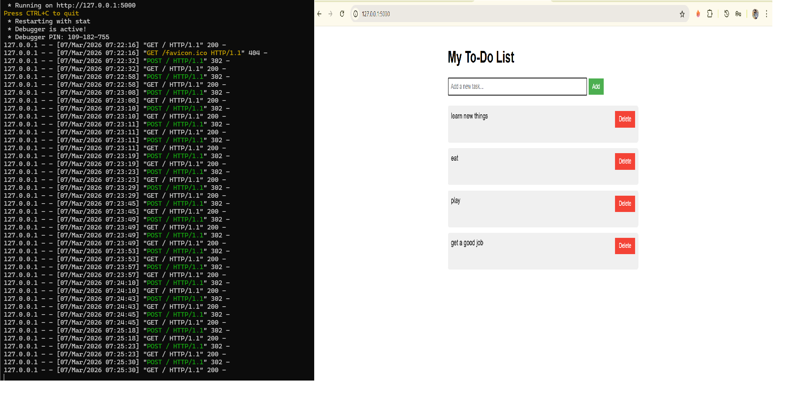

# To-Do List Web App

[](https://github.com/harshithkonatham/todo-flask-app/actions/workflows/ci.yml)

A small Flask + SQLite to-do list. I first built it as a beginner project, then
went back to make it secure, tested and deployable.



## What changed from version 1

| Problem in v1 | Risk | Fix |
|---|---|---|
| `app.run(debug=True)` | The Werkzeug debugger lets anyone who can reach it run code on the server | Debug off by default; production uses gunicorn |
| No CSRF protection | Another website could add or delete tasks in your browser | CSRF token on every form (Flask-WTF) |
| `del tasks[int(index)]` | `abc` or `999` crashed the request with a 500; two tabs could delete the wrong task | Delete by database ID; unknown IDs return 404 |
| Tasks kept in memory | Lost on every restart | SQLite with parameterised queries |
| No input limits | Unbounded task text and request size | 200-character tasks (app + DB `CHECK`), 16 KB request limit |
| No response headers | Clickjacking, MIME sniffing | Strict CSP (no inline styles), `DENY` framing, `nosniff`, `no-referrer` |
| No tests | — | 21 tests at 98% coverage, including security tests |

## Run it

Needs [uv](https://docs.astral.sh/uv/).

```bash
uv sync
uv run flask --app todo run          # http://127.0.0.1:5000
uv run pytest --cov                  # tests
```

With Docker (non-root, read-only filesystem):

```bash
docker build -t todo-app .
docker run --rm -p 8000:8000 --read-only --tmpfs /tmp -v todo-data:/data \
  -e SECRET_KEY="$(openssl rand -hex 32)" todo-app
```

| Variable | Default | Purpose |
|---|---|---|
| `SECRET_KEY` | random per process | Signs the session and CSRF tokens. **Set it in production.** |
| `DATABASE` | `instance/todo.db` | SQLite file path |
| `SESSION_COOKIE_SECURE` | `false` | Set `true` when served over HTTPS |

## CI

[`.github/workflows/ci.yml`](.github/workflows/ci.yml) runs Ruff, the tests
(90% coverage gate), Bandit, pip-audit and Gitleaks on every push. It then
lints the Dockerfile, builds the image, scans it with Grype, and runs it
read-only to check the page loads, the headers are set, and a POST without a
CSRF token is refused.

## Project layout

```text
todo/__init__.py     app factory, routes, security settings
todo/db.py           SQLite access (parameterised queries only)
todo/templates/      Jinja template (auto-escaped)
todo/static/         CSS
tests/               feature and security tests
```
